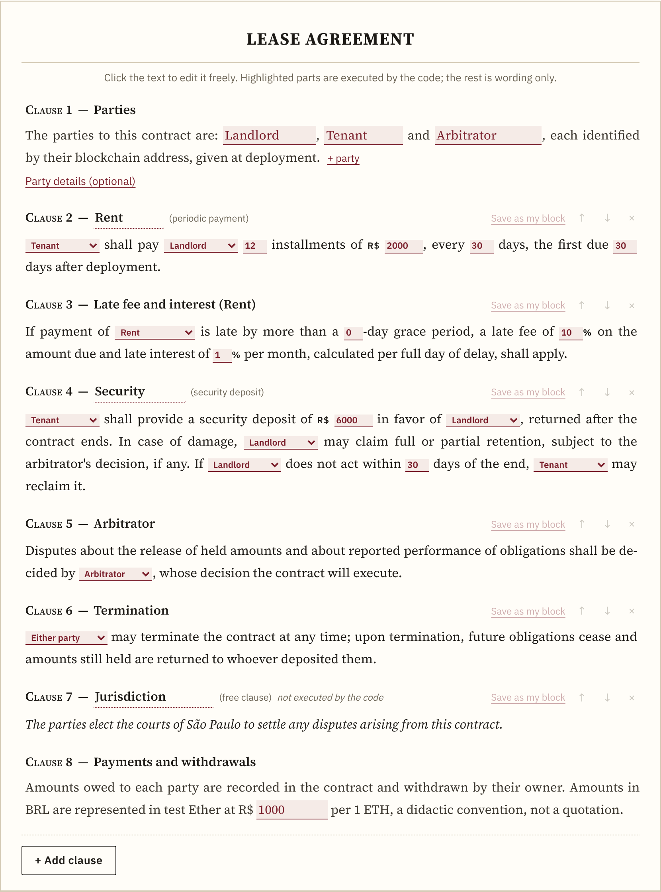
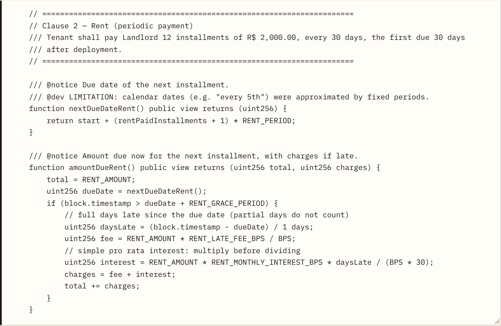
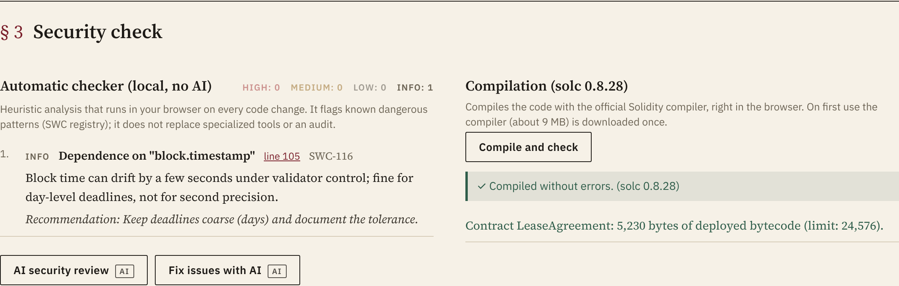
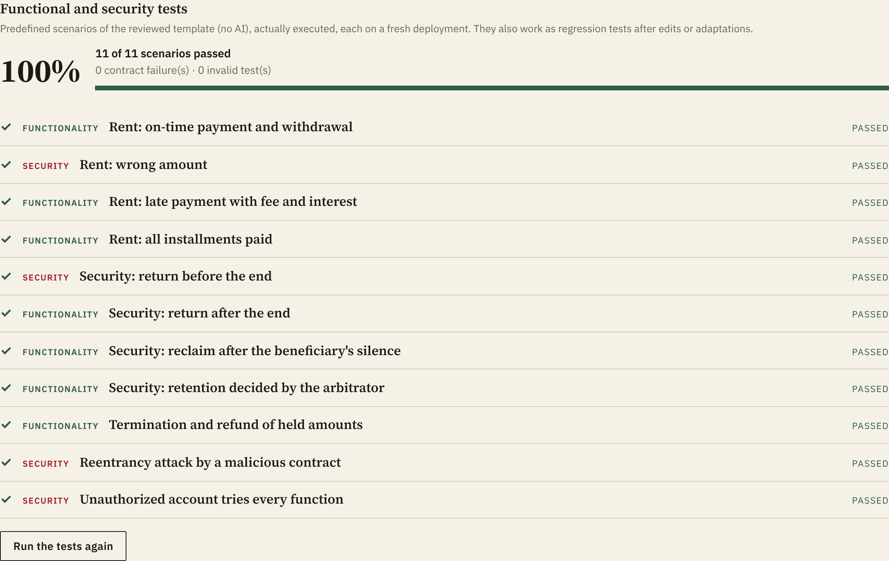
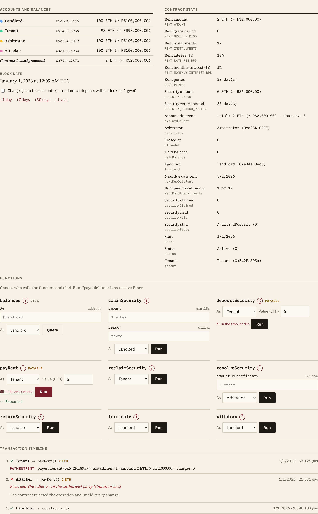
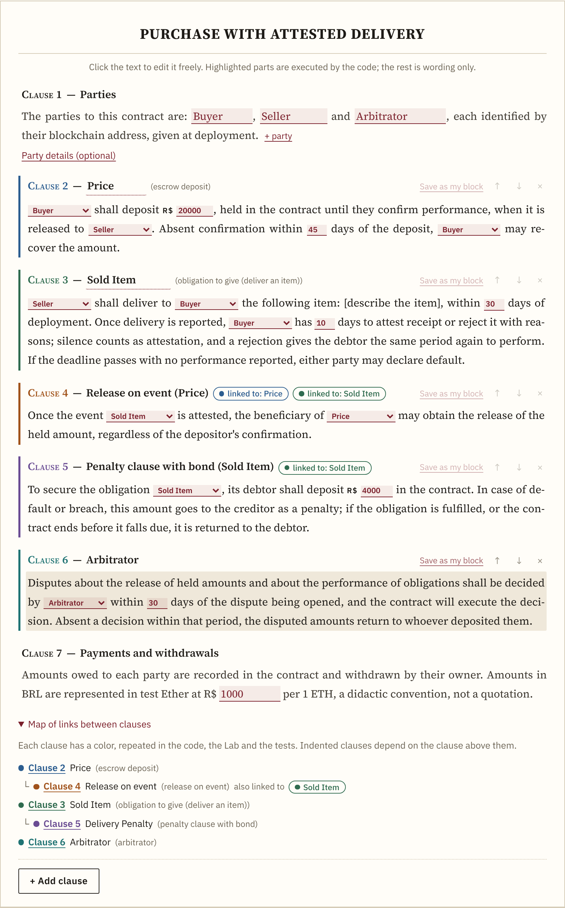
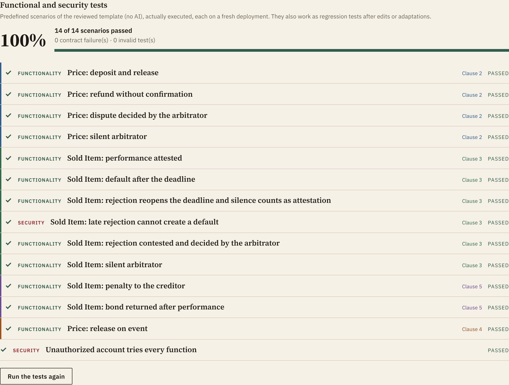

[Português](README.md) · **English**

# Contract Clause to Solidity Skeleton Converter

An educational tool that turns a contract written in plain language into a Solidity smart contract, checks the code's security and lets you test it on a simulated blockchain, all in the browser. **No programming skills and no AI are required.**

**Open the tool:** <https://educhacon.github.io/conversor_smartcontract/> (use the "English" link at the top right).

> **Notice.** This is an educational and research tool. It **does not produce code ready for real money nor legal advice**. Contracts that handle value require review by a Solidity professional and an independent security audit.



## Contents

1. [What this is, in plain words](#1-what-this-is-in-plain-words)
2. [Getting started](#2-getting-started)
3. [How to read the results](#3-how-to-read-the-results)
4. [The three conversion modes](#4-the-three-conversion-modes)
5. [Available blocks](#5-available-blocks)
6. [Obligations to give, do and not do](#6-obligations-to-give-do-and-not-do)
7. [Signatures, witnesses and legal check](#7-signatures-witnesses-and-legal-check)
8. [External data and data files](#8-external-data-and-data-files)
9. [Ether price and gas cost](#9-ether-price-and-gas-cost)
10. [Artificial intelligence (optional)](#10-artificial-intelligence-optional)
11. [Taking the contract to a real testnet](#11-taking-the-contract-to-a-real-testnet)
12. [Contract security](#12-contract-security)
13. [Glossary](#13-glossary)
14. [FAQ](#14-faq)
15. [Limitations](#15-limitations)
16. [For developers](#16-for-developers)
17. [Authorship and license](#17-authorship-and-license)

## 1. What this is, in plain words

A **smart contract** is a program published on a blockchain that carries out part of an agreement on its own: it receives payments, holds money in escrow, releases funds when a condition is met and rejects anyone who is not entitled. Once published, nobody can change it, and every operation is recorded.

This tool bridges the **legal text** and the **code**:

- you build the contract as a normal document, clause by clause;
- behind the scenes, each clause becomes reviewed Solidity code, with the clause itself quoted as a comment;
- the code is checked, compiled and **actually tested** on a simulated blockchain in the browser, including against fraud attempts.

**What it does not do:** it does not publish anything on a real network, move money, replace a lawyer or auditor, or automate what depends on the real world (e.g. whether a property was handed over). In those cases the contract relies on a party's or an arbitrator's confirmation, and the code records that limitation.

## 2. Getting started

The page has a **"How to use: hands-on tutorials"** section with **guided walkthroughs on the page itself**. The steps below summarize the first tutorial.

**Step 1 — Choose "Build a contract" and an example.** Under "Start from an example", pick a contract: lease, installment sale, milestone services, escrow purchase, indexed lease, payment at market price, purchase with delivery tracking, service with penalty and non-compete, purchase with attested delivery, formal sale (with signatures and witnesses), or monthly subscription. It appears as a document with numbered clauses.

**Step 2 — Edit the contract.** Click the text to rewrite it freely. The **highlighted parts** (parties, amounts, deadlines and percentages) are what the code executes; change them in the fields themselves. Use **"+ Add clause"** to include new blocks. If the text mentions an amount outside the highlighted parts, the page warns that it will not be executed.

**Step 3 — Generate the smart contract.** Click **"Generate the smart contract"**. The code appears below and then automatically follows your changes to the contract.



**Step 4 — Check security.** Section § 3 shows the automatic checker and the compilation result.



**Step 5 — Test.** In section § 4, click **"Run the predefined tests"**. To test by hand, click **"Deploy and interact"**: choose who calls each function, enter amounts, move time forward and follow balances and records. The **"i"** button explains each function.





**Step 6 — Keep a record.** Use **"Report"** to download a file with the contract, code, checks and tests (or **"Print / PDF"**), **"Download .sol"** for the code, and **"Save contract (.json)"** to reopen the contract later with **"Open contract"**.

## 3. How to read the results

| Where | What it means |
|---|---|
| **Automatic checker** | Flags known dangerous patterns by severity (high, medium, low, info). Reviewed blocks and templates should show no relevant findings. |
| **Compilation** | "Compiled without errors" means the official Solidity compiler accepted the code. |
| **Test score** | Share of scenarios passed. **Passed**: the contract behaved as it should. **Failed**: it accepted what it should reject, or rejected what it should accept. **Invalid test**: the test itself is faulty, which does not indicate a contract failure. |
| **Rejection ("revert")** | The contract rejected the operation and undid everything. The reason is shown in full, e.g. "Unauthorized" (the caller is not the entitled party) or "WrongAmount" (the amount differs from what is due). |
| **Reentrancy attack** | A real attacker contract takes a creditor's place and tries to withdraw the same credit several times. The test passes if it receives only what it is owed, once. |
| **Solvency** | Confirms that the money held by the contract equals exactly what the parties are owed plus what is held in guarantees. |
| **"i" button** | Explains each function: the clause it implements, who can call it, when, and why it may be rejected. |

## 4. The three conversion modes

| Mode | Uses AI? | Purpose |
|---|---|---|
| **Build a contract** (default) | No | Build the contract from reviewed blocks with freely editable text. Reproducible result. |
| **Ready-made templates** | No | Quick test: paste a clause and its amounts are extracted by rules into one of four templates (lease, escrow sale, milestone services and loan). |
| **Free text** | Yes | Convert any clause with AI, with automatic checking, compilation and fixing. |

## 5. Available blocks

Blocks are listed under **"+ Add clause"**, grouped by category. Some attach to another clause (e.g. the late fee applies to a payment) and show that link in a field of their own.

| Category | Block | What it does |
|---|---|---|
| Obligations to pay | One-time payment | One party pays the other an amount within a deadline. |
| | Periodic payment | Installments every so many days (rent, installments, fees). |
| | Stablecoin payment | Payment in a BRL-pegged token (test tBRL), with the debtor's prior approval. |
| | Late fee and interest | Charges for late payment, linked to a payment, with a grace period. |
| | Acceleration | After a prolonged delay, the creditor accelerates the outstanding balance. |
| Obligations to give, do and not do | Obligation to give | Delivery of an item, attested by the designated party (see section 6). |
| | Obligation to do | A service or act, attested by the designated party. |
| | Obligation not to do | Abstaining for a period; a breach is recorded by the designated party. |
| | Penalty clause with bond | The debtor deposits an amount that goes to the creditor if the obligation is breached. |
| Guarantees | Escrow deposit | Amount held until performance is confirmed; refunded if the deadline passes. |
| | Security deposit | Returned after the contract ends; retention decided by the arbitrator. |
| Performance | Milestone deliveries | Payment per approved milestone, with reasoned rejection and tacit approval. |
| Dispute resolution | Arbitrator | Decides, within a set period, disputes over held amounts and over the performance of obligations. |
| External data | External data: value | An index, price or other number reported by a designated source, with a validity period. |
| | External data: event | A fact attested by a designated source (e.g. the carrier confirms delivery). |
| | Index adjustment | Adjusts a payment amount by the external data. |
| | BRL amount at market price | Converts a BRL amount into Ether at the time of payment. |
| | Release on event | Releases the escrow deposit once the event is attested or the obligation is fulfilled. |
| | Right of withdrawal | Holds the payment (or deposit) during the withdrawal period and refunds it if the payer withdraws. |
| Formalities and signatures | Subject matter, Jurisdiction, Place and date, Notices, Confidentiality, Data protection, General provisions | Ready-made, editable formal clauses; part of the contract but not executed by the code. |
| | Recorded notices | A party records in the contract a notice to the other, proving its content and date. |
| | Digital signatures | The contract comes into force only when everyone signs with their wallet, checking the text fingerprint (see section 7). |
| | Witness | A signatory who is not a party; signs like the others. |
| Termination | Termination | Closes the contract and returns held amounts to whoever deposited them. |
| | Term | Closes the contract after a period. |
| Free wording | Free clause | Any text (jurisdiction, confidentiality, item description...). Part of the contract but not executed by the code. |

**Colors and links.** Each clause has a color, repeated in the document, in the legend above the code, in the Lab function cards and in the tests. Clauses that depend on another show a "linked to" tag, and the **"Map of links between clauses"**, at the end of the document, shows the whole picture. In function names, an underscore separates the act from the clause (e.g. `pay_Rent`), and the Lab also shows the full title ("Pay · Rent").

**Reuse.** A clause can be saved in **"My blocks"**, together with the clauses linked to it (e.g. the rent with its late fee). The whole contract can be saved in **"My templates"** with **"Save as my template"**; it is then listed under "Start from an example", as a basis for other contracts. Blocks and templates are stored in the browser and can be exported or imported as files, to use on another computer or to share.

## 6. Obligations to give, do and not do

Code cannot see the real world: it does not know whether a car was delivered or a service was well done. So each obligation names **who attests** performance (usually the creditor, or a trusted third party), and the contract records each step:

| Obligation | How it works in the contract |
|---|---|
| **Give** (deliver an item) and **do** | a) the debtor reports performance within the deadline; b) the attesting party has a period to confirm it or reject it with a reason; silence counts as attestation; c) a rejection gives the debtor the same period again to perform and, if there is an arbitrator, the debtor may refer it to them; d) once the deadline passes with no performance reported, either party declares default. After the attestation period, a rejection is no longer accepted. |
| **Not do** | a) during the period, the attesting party may record a breach, describing the fact; with an arbitrator, the breach depends on their confirmation; b) once the period ends without breach, either party declares the obligation fulfilled. |
| **Penalty clause** | a) the debtor deposits the bond; b) if the obligation is breached, it goes automatically to the creditor; c) if it is fulfilled, or the contract ends before the due date, it returns to the debtor. Terminating after the deadline does not free a defaulting debtor. |

The debtor can never attest their own obligation, and the arbitrator cannot be a party to it; the page flags these situations before generating the code. When the attesting party is the creditor and there is no arbitrator, the page warns that the outcome depends on the creditor's good faith. In the clause text, replace "[describe the item]" (or the service, or the conduct) with the real description; the page warns until this is done.

**Arbitrator with a deadline.** The arbitrator has a period to decide each dispute. Without a decision in that period, either party ends the dispute and the amounts return to whoever deposited them, so no amount is stuck in the contract because someone stays silent. An obligation to give or to do can also release an escrow deposit: for example, the price is held and released to the seller once the buyer attests receipt of the item.





## 7. Signatures, witnesses and legal check

**Digital signatures (optional block).** With the "Digital signatures" block, the smart contract is deployed awaiting signatures. Each signatory (parties, arbitrator, data sources and witnesses) calls `sign` with the fingerprint (SHA-256) of the contract text, shown in the clause itself and verifiable against the file **"Download the contract text (.txt)"**. The contract comes into force with the last signature, and deadlines run from that date. If not everyone signs in time, any signatory may cancel the contract.

**Legally valid signature.** A wallet signature proves that each address accepted that text, but does not identify the person. To bind the smart contract to a document signed as the law requires:
1. fill in the details under **"Party details"** (name or company name, ID and address); they go into the signed text and its fingerprint, **never into the code**;
2. generate the PDF with **"Print for signature (PDF)"**;
3. sign the PDF with the service of your choice: in Brazil, gov.br or an ICP-Brasil certificate; elsewhere, an equivalent service (e.g. a qualified eIDAS certificate);
4. compute, on the page itself, the fingerprint of the signed PDF (the file never leaves the browser);
5. before the first signature, record it in the contract with `recordDocument`.

**Witnesses.** The "Witness" block adds a signatory who cannot have any other role in the contract.

**Legal check.** Below the document, the **"Legal check"** lists indicative reminders and warnings, with the legal reference (Brazilian law). It flags, for example, missing party details or subject matter, a penalty above the contract payments, late fees and interest above usual limits, a lease deposit above three months of rent, the need for a public deed and registration in real-estate deals, and personal data in the clause text. It does not block code generation and does not replace professional advice.

**Other useful clauses.** "Right of withdrawal" holds the amount during the withdrawal period; "Recorded notices" keeps proof of a communication in the contract; and the formal clauses (subject matter, jurisdiction, place and date, notices, confidentiality, data protection and general provisions) complete the document.

## 8. External data and data files

A contract may depend on data from outside the blockchain, such as an adjustment index, a price or a delivery confirmation. In practice, such data arrives through an **oracle**: a source designated in the contract, the only one allowed to record it.

- **External data: value.** The source records a number with two decimal places (4.25% is entered as 425). Each record is valid for the validity period; afterwards, the contract refuses to use the data until it is updated.
- **External data: event.** The source attests, once, that the fact occurred.
- **Data series.** For value data, **"Load series (CSV or JSON)"** accepts a file with `date;value` lines (e.g. `01/02/2026;0.41`) or `day;value`. In the Lab, as time moves forward, the source automatically reports the value for each date. **"Download CSV template"** provides a ready-to-fill example.
- **Party details.** Under **"Party details (optional)"**, enter each party's wallet address, for the report and for deployment on a testnet.
- **Contract file.** **"Save contract (.json)"** stores the whole contract, including wording, parties and series; **"Open contract"** restores it in any browser.

## 9. Ether price and gas cost

Contract amounts are written in Brazilian reais (BRL), but the blockchain works with Ether. The **"Ether price (ETH, BRL, USD, BTC)"** panel converts between Ether, reais, dollars and bitcoin. The main source is **CoinGecko** (price aggregated across exchanges), with **Coinbase** as a fallback; the price refreshes every 60 seconds while the panel is open.

With **"Use this price in the contract"**, BRL amounts are converted at that price and the payments clause records the source and time. Otherwise a didactic scale applies (R$ 1,000 per 1 test ETH).

The panel also fetches the **current gas price** on Ethereum mainnet (PublicNode and LlamaRPC public nodes). In the Lab, each operation shows the gas used and, when the price is known, what it would cost on mainnet today, in Ether and BRL; by ticking **"Charge gas to the accounts"**, the fee is deducted from the caller's balance, as on a real network.

## 10. Artificial intelligence (optional)

With a free key from [Google AI Studio](https://aistudio.google.com/app/apikey), the **"Assistant (AI)"** panel at the top of the page chats in plain language: it answers questions about using the tool, explains the test results and what is missing for legal validity and, given a contract text, **builds it by itself**, with parties, clauses, links and wording. The proposal is checked against the tool's own rules (and fixed by the AI if needed); one click on **"Apply to the contract, generate the code and test"** loads the contract, generates the code and runs the tests. Party details (names, IDs, addresses and wallets) are not sent to the assistant.

Besides the assistant, AI can help to:

- adapt the composed contract to the specifics of a clause (the predefined tests run again afterwards);
- analyze risks, suggest clauses, explain the code and map clause ↔ code;
- convert clauses that do not fit the blocks ("Free text" mode);
- generate additional tests.

The default model is lightweight and has the largest free quota. If it is not available for your key, the app picks another one. When the free tier limit is reached, the app waits and retries.

**Privacy:** the key stays only in your browser and is sent only to Google. On the free tier, Google may use the content sent to improve its products; do not enter personal or confidential data. The non-AI modes do not send the contract anywhere.

## 11. Taking the contract to a real testnet

1. Use **"Open in Remix"** or download the `.sol` file.
2. In Remix IDE, compile with version `0.8.28`, with optimization enabled (200 runs) and EVM `cancun`; the button already opens Remix configured this way. Without optimization, contracts with many clauses may exceed the network size limit (24 KB).
3. Install the MetaMask wallet, create a test account and select the **Sepolia** network.
4. Get free test Ether from a Sepolia faucet (see the list at [ethereum.org](https://ethereum.org/developers/docs/networks/)).
5. In Remix, under "Deploy & Run Transactions", choose **"Injected Provider - MetaMask"**, enter the parties' addresses and deploy.

**Never** use mainnet or real money without a professional audit.

## 12. Contract security

Blocks, templates and AI instructions follow, among others:

- a pinned compiler version and self-contained code;
- access control: only the entitled party performs each act;
- payment of the exact amount;
- withdrawal pattern ("pull payment"): each party withdraws its own credit;
- reentrancy protection and checks-effects-interactions order;
- no dangerous features (`tx.origin`, `selfdestruct`, `delegatecall`, `assembly`);
- explicit notes on on-chain limitations.

In every contract, the predefined tests include an unauthorized account trying each function, a reentrancy attack by a real malicious contract (when there is an Ether payment) and a solvency check at the end of each scenario. The project's automated tests compile every block, template and example, plus 60 random block combinations, and require all of them to pass functional, attack and solvency scenarios.

## 13. Glossary

| Term | Meaning |
|---|---|
| Blockchain | A public, shared record of operations that cannot be changed once written. |
| Smart contract | A program published on a blockchain that automatically enforces agreed rules. |
| Solidity | The programming language of Ethereum smart contracts. |
| Ether (ETH) | Ethereum's currency, used for payments and fees. |
| Wei | The smallest fraction of Ether (1 ETH = 10¹⁸ wei). |
| Gas | The processing cost of each operation on the network. |
| Wallet | An app that holds an account's keys and signs operations (e.g. MetaMask). |
| Deployment | Publishing the contract on the network. |
| Revert | The contract rejects the operation; nothing changes. |
| Pull payment | Each creditor withdraws its own credit, which is safer than automatic sending. |
| Testnet | A public network with worthless Ether, for experiments (e.g. Sepolia). |
| Oracle | A designated source that brings off-chain data into the contract (index, price, event). |
| Stablecoin | A token with stable value, pegged to a currency (here, test tBRL, 1 unit = R$ 1.00). |
| Reentrancy | An attack in which a malicious contract calls the withdrawal function again before the first call finishes. |
| Audit | An independent security review, indispensable before real use. |

## 14. FAQ

**Do I need AI?** No. Building contracts, ready-made templates, checks, compilation and tests all work without AI or a key.

**Is the generated contract legally valid?** The smart contract enforces the agreed rules, but legal validity depends on the law's requirements (capable parties, lawful and determined subject matter, required form) and on the parties' signatures. Use the "Legal check", fill in the party details, generate the PDF with "Print for signature (PDF)", sign it (gov.br, ICP-Brasil, eIDAS or an equivalent service) and record its fingerprint in the contract (section 7). Professional review is still recommended.

**Can I use it with real money?** No. The code is educational and requires professional review and an audit.

**Does my data go anywhere?** Without AI, the contract stays in your browser. With AI, the text goes to Google's API. The price lookup contacts CoinGecko or Coinbase, and the gas price lookup contacts public Ethereum nodes, only when you open the price panel or enable gas charging in the Lab.

**Why does the Ether amount change?** Because Ether's price varies. When the code is generated, the Ether amount is fixed by the chosen scale or price.

**What if I write something in the text that is not in the highlighted fields?** It becomes part of the wording but is not executed. The page warns when amounts appear outside the fields.

**Can I model delivery or service contracts without payment?** Yes. Use the obligation blocks (give, do or not do), with a penalty clause if you want to secure performance. See section 6.

**Can I load my own data, such as a monthly index?** Yes. Add "External data: value" and load a CSV or JSON series (section 8).

**How do I reuse a clause I wrote?** Use "Save as my block"; it becomes available under "+ Add clause" → "My blocks", with its linked clauses, and can be exported as a file.

**How do I use the same contract as a basis for others?** Use "Save as my template". It is listed under "Start from an example" → "My templates". Wallet addresses are not stored in the template.

## 15. Limitations

- The automatic checker is heuristic and does not replace specialized tools or an audit.
- The legal check is indicative, based on Brazilian law, and does not replace professional advice.
- The blocks cover a broad family of payment and obligation contracts, but not every contract.
- Real-world facts depend on whoever is designated to attest them (party, arbitrator or oracle); the contract trusts that source.
- Calendar dates are approximated by fixed periods in days.
- The simulated blockchain reproduces the EVM (Cancun) and estimates gas cost from the current network price, but it only interacts with the auxiliary test contracts (the tBRL stablecoin and the attacker contract), not with contracts deployed on a real network.
- The price is a reference and varies over time.

## 16. For developers

The site is static (HTML, CSS and JavaScript) and needs no build step to be published. To run the tests or rebuild the simulated blockchain:

```bash
npm install
```

```bash
npm test
```

```bash
npm run build
```

Main files: `assets/js/blocks.js` (blocks), `assets/js/composer.js` (contract builder), `assets/js/templates.js` (ready-made templates), `assets/js/lab.js` (Lab), `assets/js/security-scan.js` (checker), `assets/js/rates.js` (price and gas), `assets/js/prompts.js` (AI instructions), `src/evm-lab.mjs` (simulated EVM) and `contracts/` (auxiliary test contracts: attacker and stablecoin).

## 17. Authorship and license

© 2025-2026 Eduardo Chacon ([github.com/EduChacon](https://github.com/EduChacon)). **All rights reserved.** Using the tool through the published page is free for personal, educational and research purposes. Copying, modifying or redistributing the code requires prior permission: see the [`LICENSE`](LICENSE) file. Third-party components keep their own licenses.
