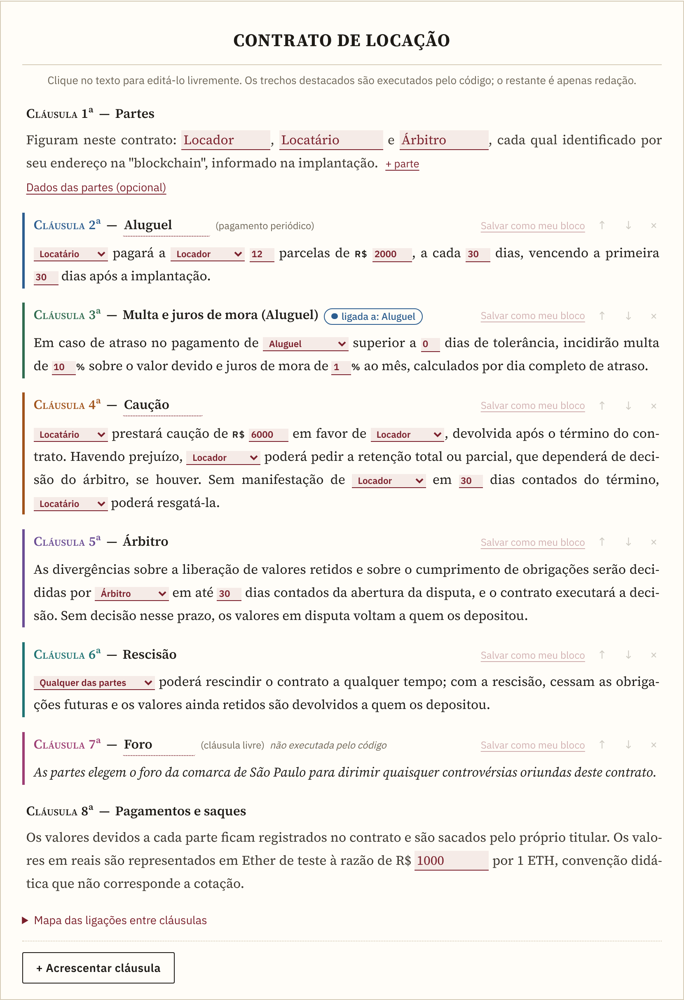
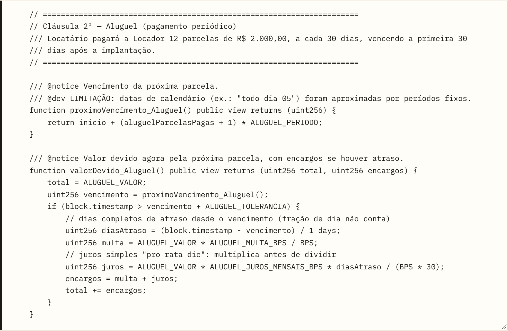
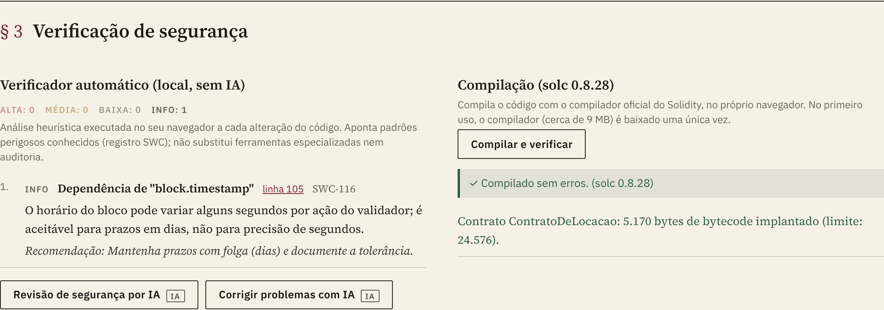
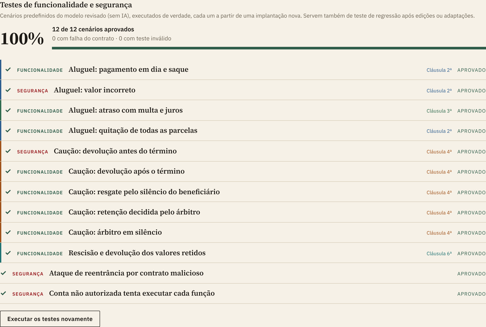
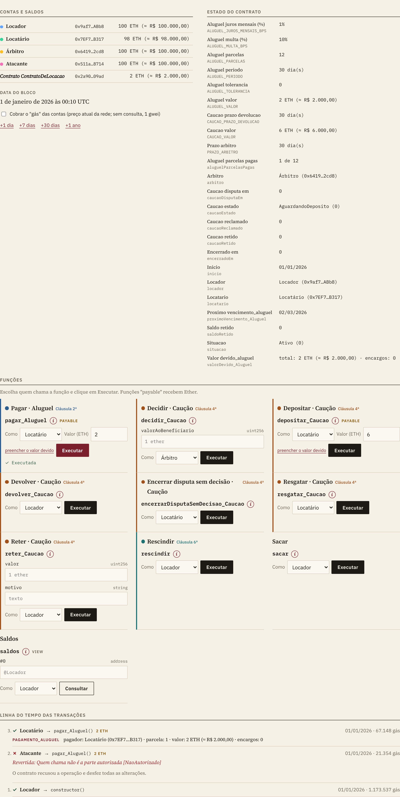
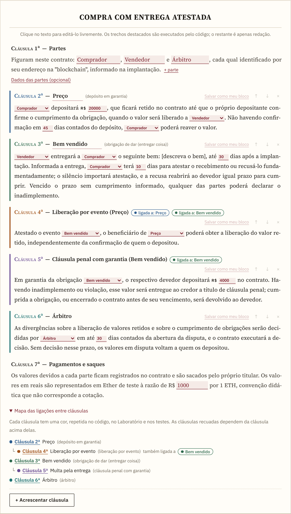
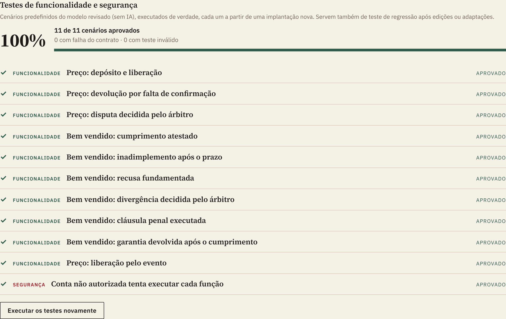
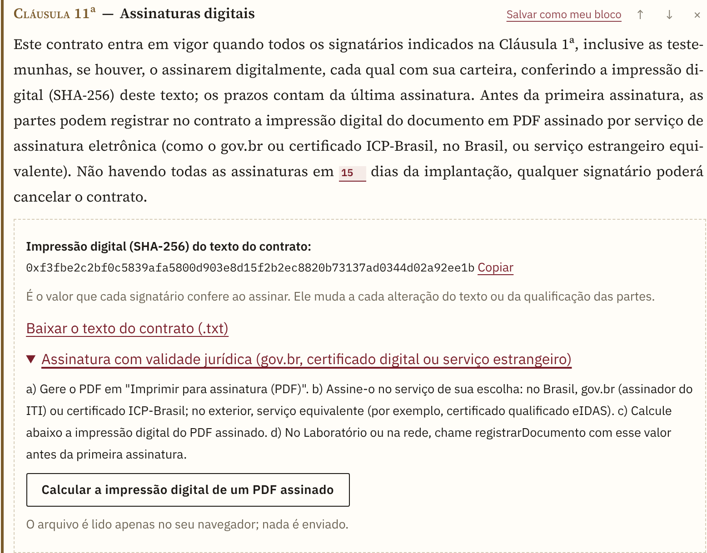
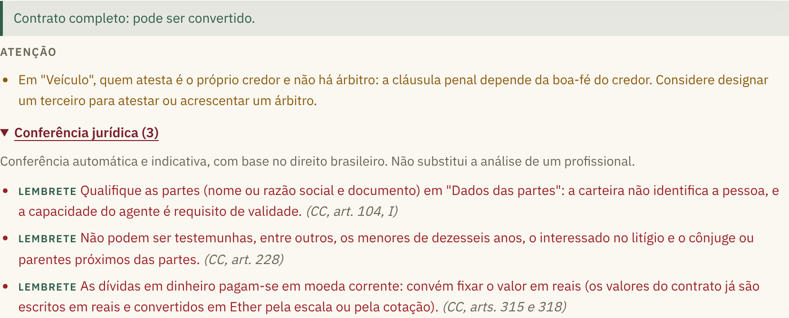
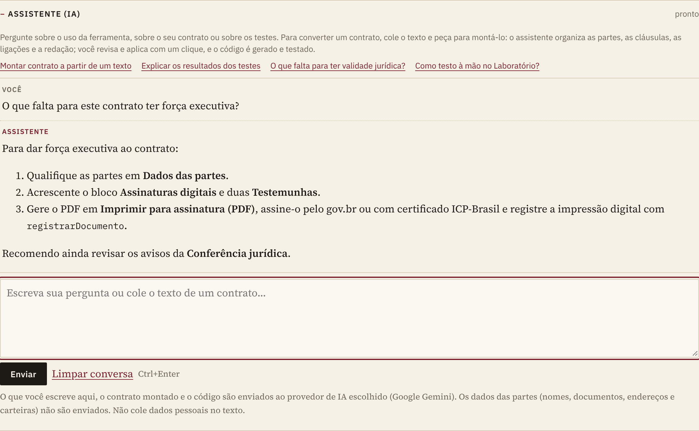

**Português** · [English](README.en.md)

# Conversor Contratual para Esqueleto Solidity

Ferramenta educacional que transforma um contrato escrito em linguagem comum num "smart contract" (contrato inteligente) em Solidity, verifica a segurança do código e permite testá-lo numa "blockchain" simulada, tudo no navegador. **Não é preciso saber programar nem usar inteligência artificial.**

**Acesse:** <https://educhacon.github.io/conversor_smartcontract/>

> **Advertência.** A ferramenta tem finalidade educacional e de pesquisa. Ela **não produz código pronto para uso com dinheiro real nem aconselhamento jurídico**. Contratos que movimentem valores exigem revisão por profissional de Solidity e auditoria de segurança independente.



## Sumário

1. [O que é isto, em linguagem simples](#1-o-que-é-isto-em-linguagem-simples)
2. [Primeiros passos](#2-primeiros-passos)
3. [Como ler os resultados](#3-como-ler-os-resultados)
4. [Os três modos de conversão](#4-os-três-modos-de-conversão)
5. [Blocos disponíveis](#5-blocos-disponíveis)
6. [Obrigações de dar, fazer e não fazer](#6-obrigações-de-dar-fazer-e-não-fazer)
7. [Assinaturas, testemunhas e conferência jurídica](#7-assinaturas-testemunhas-e-conferência-jurídica)
8. [Informações externas e arquivos de dados](#8-informações-externas-e-arquivos-de-dados)
9. [Cotação do Ether e custo de "gás"](#9-cotação-do-ether-e-custo-de-gás)
10. [Inteligência artificial (opcional)](#10-inteligência-artificial-opcional)
11. [Levar o contrato a uma rede de teste real](#11-levar-o-contrato-a-uma-rede-de-teste-real)
12. [Segurança dos contratos](#12-segurança-dos-contratos)
13. [Glossário](#13-glossário)
14. [Perguntas frequentes](#14-perguntas-frequentes)
15. [Limitações](#15-limitações)
16. [Para desenvolvedores](#16-para-desenvolvedores)
17. [Autoria e licença](#17-autoria-e-licença)

## 1. O que é isto, em linguagem simples

Um **"smart contract"** é um programa publicado numa "blockchain" que executa sozinho parte de um contrato: recebe pagamentos, guarda valores em garantia, libera dinheiro quando uma condição se cumpre e recusa quem não tem direito. Ninguém pode alterá-lo depois de publicado, e cada operação fica registrada.

Esta ferramenta faz a ponte entre o **texto jurídico** e o **código**:

- você monta o contrato como um documento comum, cláusula por cláusula;
- por trás, cada cláusula vira um trecho de código Solidity já revisado, com a própria cláusula transcrita em comentário;
- o código é verificado, compilado e **testado de verdade** numa "blockchain" simulada no navegador, inclusive contra tentativas de fraude.

**O que ela não faz:** não publica nada numa rede real, não movimenta dinheiro, não substitui advogado nem auditor e não automatiza o que depende do mundo real (por exemplo, verificar se um imóvel foi entregue). Nesses casos, o contrato depende da confirmação de uma parte ou de um árbitro, e o código registra essa limitação.

## 2. Primeiros passos

A página traz a seção **"Como usar: tutoriais práticos"**, com **passo a passo guiado na própria tela**. O roteiro abaixo resume o primeiro tutorial.

**Passo 1 — Escolha o modo "Montar contrato" e um exemplo.** Em "Começar de um exemplo", escolha um contrato: locação, compra parcelada, serviços por etapas, compra com garantia, locação com reajuste, pagamento pela cotação, compra com rastreio de entrega, serviço com cláusula penal e não concorrência, compra com entrega atestada, compra e venda formal (com assinaturas e testemunhas) ou assinatura mensal. Ele aparece como um documento, com cláusulas numeradas.

**Passo 2 — Edite o contrato.** Clique no texto para reescrevê-lo livremente. Os **trechos destacados** (partes, valores, prazos e percentuais) são os que o código executa; altere-os nos próprios campos. Use **"+ Acrescentar cláusula"** para incluir novos blocos. Se o texto mencionar um valor fora dos trechos destacados, a página avisa que ele não será executado.

**Passo 3 — Gere o "smart contract".** Clique em **"Gerar o 'smart contract'"**. O código aparece logo abaixo e passa a acompanhar automaticamente as alterações feitas no contrato.



**Passo 4 — Confira a segurança.** A seção § 3 mostra o verificador automático e o resultado da compilação.



**Passo 5 — Teste.** Na seção § 4, clique em **"Executar os testes predefinidos"**. Para testar à mão, clique em **"Implantar e interagir"**: escolha quem chama cada função, informe valores, avance o tempo e acompanhe saldos e registros. O botão **"i"** explica cada função.





**Passo 6 — Guarde o resultado.** Use **"Relatório"** para baixar um arquivo com o contrato, o código, a verificação e os testes (ou **"Imprimir / PDF"**), **"Baixar .sol"** para o código e **"Salvar contrato (.json)"** para reabrir a montagem depois, com **"Abrir contrato"**.

## 3. Como ler os resultados

| Onde | O que significa |
|---|---|
| **Verificador automático** | Aponta padrões perigosos conhecidos, por gravidade (alta, média, baixa, informativa). Nos blocos e modelos revisados, não deve haver achados relevantes. |
| **Compilação** | "Compilado sem erros" significa que o compilador oficial do Solidity aceitou o código. |
| **Placar dos testes** | Percentual de cenários aprovados. **Aprovado**: o contrato agiu como deveria. **Falhou**: aceitou o que devia recusar, ou recusou o que devia aceitar. **Teste inválido**: o próprio teste é defeituoso, o que não indica falha do contrato. |
| **Recusa ("reversão")** | O contrato recusou a operação e desfez tudo. O motivo aparece por extenso: por exemplo, "NaoAutorizado" (quem chamou não é a parte autorizada) ou "ValorIncorreto" (o valor difere do devido). |
| **Ataque de reentrância** | Um contrato atacante de verdade ocupa o lugar de um credor e tenta sacar o mesmo crédito várias vezes. O teste passa se ele receber só o que lhe é devido, uma única vez. |
| **Solvência** | Confere que o dinheiro guardado no contrato é exatamente a soma do que as partes têm a receber mais o que está retido em garantia. |
| **Botão "i"** | Explica cada função: a cláusula que ela implementa, quem pode chamá-la, quando e por quais motivos pode ser recusada. |

## 4. Os três modos de conversão

| Modo | Usa IA? | Para quê |
|---|---|---|
| **Montar contrato** (padrão) | Não | Montar o contrato com blocos revisados e texto livremente editável. Resultado reprodutível. |
| **Modelos prontos** | Não | Testar rapidamente: cole uma cláusula, e os valores são extraídos por regras para um dos quatro modelos (locação, compra e venda com garantia, serviços por etapas e mútuo). |
| **Texto livre** | Sim | Converter qualquer cláusula com a IA, com verificação, compilação e correção automáticas. |

## 5. Blocos disponíveis

Os blocos aparecem em **"+ Acrescentar cláusula"**, agrupados por categoria. Alguns se ligam a outra cláusula (por exemplo, a multa se aplica a um pagamento) e indicam essa ligação num campo próprio.

| Categoria | Bloco | O que faz |
|---|---|---|
| Obrigações de pagar | Pagamento único | Uma parte paga à outra um valor, em prazo definido. |
| | Pagamento periódico | Parcelas a cada tantos dias (aluguel, prestações, mensalidades). |
| | Pagamento em "stablecoin" | Pagamento em token lastreado em reais (tBRL de teste), com autorização prévia do devedor. |
| | Multa e juros de mora | Encargos por atraso, ligados a um pagamento, com tolerância. |
| | Vencimento antecipado | Após atraso prolongado, o credor antecipa o saldo devedor. |
| Obrigações de dar, fazer e não fazer | Obrigação de dar | Entrega de coisa, atestada por quem foi designado (veja a seção 6). |
| | Obrigação de fazer | Prestação de serviço ou ato, atestada por quem foi designado. |
| | Obrigação de não fazer | Abstenção por um prazo; a violação é registrada por quem foi designado. |
| | Cláusula penal com garantia | O devedor deposita um valor que vai ao credor se a obrigação for descumprida. |
| Garantias | Depósito em garantia | Valor retido até a confirmação do cumprimento; devolução se o prazo vencer. |
| | Caução | Garantia devolvida após o término; retenção decidida pelo árbitro. |
| Execução | Entregas por etapas | Pagamento por etapa aprovada, com recusa fundamentada e aprovação tácita. |
| Solução de disputas | Árbitro | Decide, em prazo definido, as disputas sobre valores retidos e sobre o cumprimento de obrigações. |
| Informações externas | Informação externa: valor | Índice, cotação ou outro número informado por uma fonte designada, com prazo de validade. |
| | Informação externa: evento | Fato atestado por uma fonte designada (por exemplo, a transportadora confirma a entrega). |
| | Reajuste por índice | Corrige o valor de um pagamento pela informação externa. |
| | Valor em reais pela cotação | Converte em Ether, no momento do pagamento, um valor fixado em reais. |
| | Liberação por evento | Libera o depósito em garantia quando o evento é atestado ou a obrigação é cumprida. |
| | Direito de arrependimento | Retém o pagamento (ou o depósito) pelo prazo de desistência e o devolve se o pagador desistir. |
| Formalização e assinaturas | Objeto, Foro de eleição, Local e data, Comunicações, Confidencialidade, Proteção de dados, Disposições gerais | Cláusulas formais prontas e editáveis; integram o contrato, mas não são executadas pelo código. |
| | Notificações registradas | Uma parte registra no contrato notificação à outra, com prova do conteúdo e da data. |
| | Assinaturas digitais | O contrato só entra em vigor quando todos assinam com a carteira, conferindo a impressão digital do texto (veja a seção 7). |
| | Testemunha | Signatário que não é parte; assina como os demais. |
| Encerramento | Rescisão | Encerra o contrato e devolve os valores retidos a quem os depositou. |
| | Prazo de vigência | Encerra o contrato após o prazo. |
| Redação livre | Cláusula livre | Qualquer texto (foro, confidencialidade, descrição do bem...). Integra o contrato, mas não é executada pelo código. |

**Cores e ligações.** Cada cláusula tem uma cor, repetida no documento, na legenda acima do código, nos cartões de função do Laboratório e nos testes. As cláusulas que dependem de outra exibem a marca "ligada a", e o **"Mapa das ligações entre cláusulas"**, no fim do documento, mostra o conjunto. Nos nomes das funções, um sublinhado separa o ato da cláusula (por exemplo, `pagar_Aluguel`), e o Laboratório mostra também o título por extenso ("Pagar · Aluguel").

**Reaproveitar.** Uma cláusula pode ser salva em **"Meus blocos"**, junto com as cláusulas ligadas a ela (por exemplo, o aluguel com a multa). O contrato inteiro pode ser salvo em **"Meus modelos"**, com **"Salvar como meu modelo"**; ele passa a aparecer em "Começar de um exemplo", para servir de base a outros contratos. Blocos e modelos ficam no navegador e podem ser exportados ou importados em arquivo, para usar em outro computador ou compartilhar.

## 6. Obrigações de dar, fazer e não fazer

O código não enxerga o mundo real: não sabe se um carro foi entregue ou se um serviço foi bem feito. Por isso, cada obrigação indica **quem atesta** o cumprimento (normalmente o credor, ou um terceiro de confiança), e o contrato registra cada passo:

| Obrigação | Como funciona no contrato |
|---|---|
| **Dar** (entregar coisa) e **fazer** | a) o devedor informa o cumprimento dentro do prazo; b) quem atesta tem um prazo para confirmar ou recusar com motivo; o silêncio vale como atestação; c) a recusa reabre ao devedor igual prazo para cumprir de novo e, havendo árbitro, o devedor pode submetê-la a ele; d) vencido o prazo sem cumprimento informado, qualquer das partes declara o inadimplemento. Esgotado o prazo para atestar, a recusa não é mais aceita. |
| **Não fazer** | a) durante o prazo, quem atesta pode registrar a violação, com a descrição do fato; havendo árbitro, a violação depende de sua confirmação; b) findo o prazo sem violação, qualquer das partes declara a obrigação cumprida. |
| **Cláusula penal** | a) o devedor deposita a garantia; b) descumprida a obrigação, ela passa automaticamente ao credor; c) cumprida a obrigação, ou encerrado o contrato antes do vencimento, volta ao devedor. Rescindir depois do prazo vencido não livra o devedor inadimplente. |

O devedor nunca pode atestar a própria obrigação, e o árbitro não pode ser parte dela; a página aponta essas situações antes de gerar o código. Quando quem atesta é o próprio credor e não há árbitro, a página avisa que o resultado depende da boa-fé do credor. No texto da cláusula, substitua "[descreva o bem]" (ou o serviço, ou a conduta) pela descrição real; a página avisa enquanto isso não for feito.

**Árbitro com prazo.** O árbitro tem um prazo para decidir cada disputa. Sem decisão nesse prazo, qualquer das partes encerra a disputa e os valores voltam a quem os depositou, de modo que nenhum valor fica preso no contrato pelo silêncio de alguém. A obrigação de dar ou de fazer também pode liberar um depósito em garantia: por exemplo, o preço fica retido e é liberado ao vendedor quando o comprador atesta o recebimento do bem.





## 7. Assinaturas, testemunhas e conferência jurídica

**Assinaturas digitais (bloco opcional).** Com o bloco "Assinaturas digitais", o "smart contract" é implantado aguardando as assinaturas. Cada signatário (partes, árbitro, fontes de informação e testemunhas) chama `assinar` com a impressão digital (SHA-256) do texto do contrato, que aparece na própria cláusula e pode ser conferida com o arquivo **"Baixar o texto do contrato (.txt)"**. O contrato entra em vigor com a última assinatura, e os prazos contam dessa data. Sem todas as assinaturas no prazo, qualquer signatário pode cancelar o contrato.

**Assinatura com validade jurídica.** A assinatura pela carteira prova que cada endereço aceitou aquele texto, mas não identifica a pessoa. Para vincular o "smart contract" a um documento assinado na forma da lei:
1. preencha a qualificação em **"Dados das partes"** (nome ou razão social, documento e endereço); ela entra no texto assinado e na impressão digital, **nunca no código**;
2. gere o PDF com **"Imprimir para assinatura (PDF)"**;
3. assine o PDF no serviço de sua escolha: no Brasil, gov.br ou certificado ICP-Brasil; no exterior, serviço equivalente (por exemplo, certificado qualificado eIDAS);
4. calcule, na própria página, a impressão digital do PDF assinado (o arquivo não sai do navegador);
5. antes da primeira assinatura, registre-a no contrato com `registrarDocumento`.



**Testemunhas.** O bloco "Testemunha" acrescenta um signatário que não pode ter nenhum outro papel no contrato.

**Conferência jurídica.** Abaixo do documento, a **"Conferência jurídica"** reúne lembretes e avisos indicativos, com a referência legal (direito brasileiro). Ela aponta, por exemplo, a falta de qualificação das partes ou de descrição do objeto, a cláusula penal superior ao valor das prestações, a multa e os juros acima dos limites usuais, a caução de locação acima de três aluguéis, a necessidade de escritura e registro em negócios imobiliários e dados pessoais no texto das cláusulas. A conferência não impede a geração do código e não substitui a análise de um profissional.



**Outras cláusulas úteis.** "Direito de arrependimento" retém o valor pelo prazo de desistência; "Notificações registradas" deixa no contrato a prova de uma comunicação; e as cláusulas formais (objeto, foro, local e data, comunicações, confidencialidade, proteção de dados e disposições gerais) completam o documento.

## 8. Informações externas e arquivos de dados

Um contrato pode depender de dados de fora da "blockchain", como um índice de reajuste, uma cotação ou a confirmação de uma entrega. Na prática, esses dados chegam por um **oráculo**: uma fonte designada no contrato, a única autorizada a registrá-los.

- **Informação externa: valor.** A fonte registra um número com duas casas decimais (4,25% é informado como 425). Cada registro vale pelo prazo de validade; depois dele, o contrato se recusa a usar o dado até nova atualização.
- **Informação externa: evento.** A fonte atesta, uma única vez, que o fato ocorreu.
- **Série de dados.** Numa informação de valor, **"Carregar série (CSV ou JSON)"** recebe um arquivo com linhas `data;valor` (ex.: `01/02/2026;0,41`) ou `dia;valor`. No Laboratório, ao avançar o tempo, a fonte informa automaticamente o valor de cada data. **"Baixar modelo de CSV"** fornece um exemplo pronto para preencher.
- **Dados das partes.** Em **"Dados das partes (opcional)"**, informe o endereço de carteira de cada parte, para o relatório e para a implantação numa rede de teste.
- **Arquivo do contrato.** **"Salvar contrato (.json)"** guarda toda a montagem, inclusive redação, partes e séries; **"Abrir contrato"** a recupera em qualquer navegador.

## 9. Cotação do Ether e custo de "gás"

Os valores do contrato são escritos em reais, mas a "blockchain" trabalha com Ether. No painel **"Cotação do Ether (ETH, R$, US$, BTC)"**, você converte entre Ether, reais, dólares e bitcoin. A fonte principal é a **CoinGecko** (preço agregado de várias corretoras), com a **Coinbase** como reserva; a cotação é atualizada a cada 60 segundos enquanto o painel estiver aberto.

Com **"Usar esta cotação no contrato"**, os valores em reais passam a ser convertidos pela cotação, e a cláusula de pagamentos registra a fonte e o horário. Sem isso, vale uma escala didática (R$ 1.000 por 1 ETH de teste).

O painel também consulta o **preço atual do "gás"** na rede principal do Ethereum (nós públicos PublicNode e LlamaRPC). No Laboratório, cada operação mostra o "gás" consumido e, conhecido o preço, o custo que teria hoje na rede principal, em Ether e em reais; marcando **"Cobrar o 'gás' das contas"**, a taxa passa a ser descontada do saldo de quem chama a função, como numa rede real.

## 10. Inteligência artificial (opcional)

Com uma chave gratuita do [Google AI Studio](https://aistudio.google.com/app/apikey), o painel **"Assistente (IA)"**, no topo da página, conversa em linguagem comum: responde dúvidas sobre o uso da ferramenta, explica os resultados dos testes e o que falta para a validade jurídica e, ao receber o texto de um contrato, **monta-o sozinho**, com as partes, as cláusulas, as ligações e a redação. A proposta é conferida pelas regras da própria ferramenta (e corrigida pela IA, se preciso); com um clique em **"Aplicar ao contrato, gerar o código e testar"**, o contrato é carregado, o código é gerado e os testes são executados. Os dados das partes (nomes, documentos, endereços e carteiras) não são enviados ao assistente.



Além do assistente, a IA ajuda a:

- adaptar o contrato montado a particularidades da cláusula (os testes predefinidos são repetidos depois);
- analisar riscos, sugerir cláusulas, explicar o código e mapear cláusula ↔ código;
- converter cláusulas que não cabem nos blocos (modo "Texto livre");
- gerar testes adicionais.

O modelo padrão é leve e tem a maior cota gratuita. Se ele não estiver disponível para a chave, o aplicativo escolhe outro. No limite do plano gratuito, o aplicativo aguarda e tenta de novo.

**Privacidade:** a chave fica apenas no seu navegador e só é enviada ao Google. No plano gratuito, o Google pode usar o conteúdo enviado para aprimorar seus produtos; não insira dados pessoais nem confidenciais. Os modos sem IA não enviam o contrato a ninguém.

## 11. Levar o contrato a uma rede de teste real

1. Use **"Abrir no Remix"** ou baixe o arquivo `.sol`.
2. No Remix IDE, compile com a versão `0.8.28`, com a otimização ativada (200 "runs") e a EVM `cancun`; o botão já abre o Remix assim configurado. Sem otimização, contratos com muitas cláusulas podem exceder o limite de tamanho da rede (24 KB).
3. Instale a carteira MetaMask, crie uma conta de teste e selecione a rede **Sepolia**.
4. Obtenha Ether de teste gratuito numa "faucet" de Sepolia (há uma lista em [ethereum.org](https://ethereum.org/developers/docs/networks/)).
5. No Remix, em "Deploy & Run Transactions", escolha **"Injected Provider - MetaMask"**, informe os endereços das partes e implante.

**Nunca** use a rede principal nem dinheiro real sem auditoria profissional.

## 12. Segurança dos contratos

Os blocos, os modelos e as instruções da IA seguem, entre outros requisitos:

- versão fixa do compilador e código autocontido;
- controle de acesso: só a parte legitimada pratica cada ato;
- pagamento pelo valor exato;
- padrão de saque ("pull payment"): cada parte retira o próprio crédito;
- proteção contra reentrância e ordem "checks-effects-interactions";
- proibição de recursos perigosos (`tx.origin`, `selfdestruct`, `delegatecall`, `assembly`);
- registro das limitações do "on-chain".

Os testes predefinidos incluem, em todo contrato, a tentativa de uma conta não autorizada executar cada função, um ataque de reentrância por contrato malicioso real (quando há pagamento em Ether) e a conferência de solvência ao fim de cada cenário. Os testes automatizados do projeto compilam cada bloco, modelo e exemplo, além de 60 combinações aleatórias de blocos, e exigem que todos passem nos cenários de funcionalidade, ataque e solvência.

## 13. Glossário

| Termo | Significado |
|---|---|
| "Blockchain" | Registro público e compartilhado de operações, que não pode ser alterado depois de gravado. |
| "Smart contract" | Programa publicado na "blockchain" que executa automaticamente regras combinadas. |
| Solidity | Linguagem de programação dos "smart contracts" da rede Ethereum. |
| Ether (ETH) | Moeda da rede Ethereum, usada para pagamentos e taxas. |
| Wei | Menor fração do Ether (1 ETH = 10¹⁸ wei). |
| "Gás" | Custo de processamento de cada operação na rede. |
| Carteira | Aplicativo que guarda as chaves de uma conta e assina operações (ex.: MetaMask). |
| Implantação ("deploy") | Publicação do contrato na rede. |
| Reversão ("revert") | Recusa da operação pelo contrato; nada é alterado. |
| Saque ("pull payment") | Modelo em que cada credor retira o próprio crédito, o que é mais seguro do que o envio automático. |
| Rede de teste | Rede pública com Ether sem valor, para experimentos (ex.: Sepolia). |
| Oráculo | Fonte designada que leva ao contrato uma informação de fora da "blockchain" (índice, cotação, evento). |
| "Stablecoin" | Token de valor estável, atrelado a uma moeda (aqui, o tBRL de teste, 1 unidade = R$ 1,00). |
| Reentrância | Ataque em que um contrato malicioso chama de novo a função de saque antes que a primeira chamada termine. |
| Auditoria | Revisão independente de segurança, indispensável antes do uso real. |

## 14. Perguntas frequentes

**Preciso de IA?** Não. Montar contrato, modelos prontos, verificação, compilação e testes funcionam sem IA e sem chave.

**O contrato gerado tem validade jurídica?** O "smart contract" executa as regras combinadas, mas a validade jurídica depende dos requisitos da lei (partes capazes, objeto lícito e determinado, forma prescrita) e da assinatura das partes. Use a "Conferência jurídica", qualifique as partes, gere o PDF com "Imprimir para assinatura (PDF)", assine-o (gov.br, ICP-Brasil ou serviço equivalente) e registre sua impressão digital no contrato (seção 7). A revisão por profissional continua recomendada.

**Posso usar com dinheiro real?** Não. O código é educacional e exige revisão profissional e auditoria.

**Meus dados vão para algum lugar?** Sem IA, o contrato fica no seu navegador. Com IA, o texto vai à API do Google. A consulta de cotação acessa a CoinGecko ou a Coinbase, e a do preço do "gás", nós públicos do Ethereum, apenas quando você abre o painel de cotação ou marca a cobrança de "gás" no Laboratório.

**Por que o valor em Ether muda?** Porque o Ether tem cotação variável. Ao gerar o código, o valor em Ether fica fixado pela escala ou pela cotação escolhida.

**O que acontece se eu escrever no texto algo que não está nos campos destacados?** O texto passa a fazer parte da redação, mas não é executado. A página avisa quando há valores fora dos campos.

**Dá para fazer contratos de entrega de bem ou de serviço, sem pagamento?** Sim. Use os blocos de obrigação de dar, fazer ou não fazer, com cláusula penal se quiser garantir o cumprimento. Veja a seção 6.

**Posso carregar meus próprios dados, como um índice mês a mês?** Sim. Acrescente uma "Informação externa: valor" e carregue uma série em CSV ou JSON (seção 8).

**Como reaproveito uma cláusula que escrevi?** Use "Salvar como meu bloco"; ela fica disponível em "+ Acrescentar cláusula" → "Meus blocos", com as cláusulas ligadas, e pode ser exportada em arquivo.

**Como uso o mesmo contrato como base de outros?** Use "Salvar como meu modelo". Ele aparece em "Começar de um exemplo" → "Meus modelos". Endereços de carteira não são guardados no modelo.

## 15. Limitações

- O verificador automático é heurístico e não substitui ferramentas especializadas nem auditoria.
- A conferência jurídica é indicativa, baseada no direito brasileiro, e não substitui a análise de um profissional.
- Os blocos cobrem uma família ampla de contratos de pagamento e obrigação, mas não todo contrato.
- Fatos do mundo real dependem de quem foi designado para atestá-los (parte, árbitro ou oráculo); o contrato confia nessa fonte.
- Datas de calendário são aproximadas por períodos fixos em dias.
- A "blockchain" simulada reproduz a EVM (versão Cancun) e estima o custo de "gás" pelo preço atual da rede, mas interage apenas com os contratos auxiliares de teste (a "stablecoin" tBRL e o contrato atacante), não com contratos já implantados numa rede real.
- A cotação é de referência e varia ao longo do tempo.

## 16. Para desenvolvedores

O site é estático (HTML, CSS e JavaScript), sem etapa de compilação para publicação. Para rodar os testes ou regenerar a "blockchain" simulada:

```bash
npm install
```

```bash
npm test
```

```bash
npm run build
```

Principais arquivos: `assets/js/blocks.js` (blocos), `assets/js/composer.js` (montador), `assets/js/templates.js` (modelos prontos), `assets/js/lab.js` (Laboratório), `assets/js/security-scan.js` (verificador), `assets/js/rates.js` (cotação e "gás"), `assets/js/prompts.js` (instruções da IA), `src/evm-lab.mjs` (EVM simulada) e `contracts/` (contratos auxiliares de teste: atacante e "stablecoin").

## 17. Autoria e licença

© 2025-2026 Eduardo Chacon ([github.com/EduChacon](https://github.com/EduChacon)). **Todos os direitos reservados.** O uso da ferramenta pela página publicada é livre para fins pessoais, educacionais e de pesquisa. A cópia, modificação ou redistribuição do código exige autorização prévia: veja o arquivo [`LICENSE`](LICENSE). Componentes de terceiros mantêm as próprias licenças.
