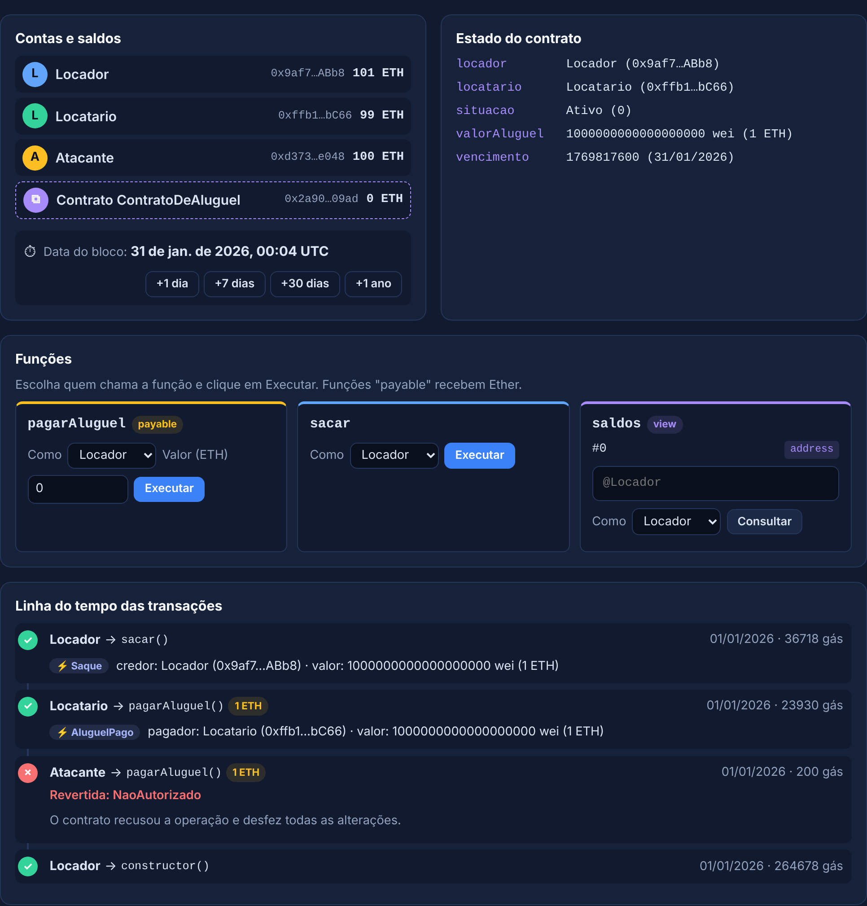
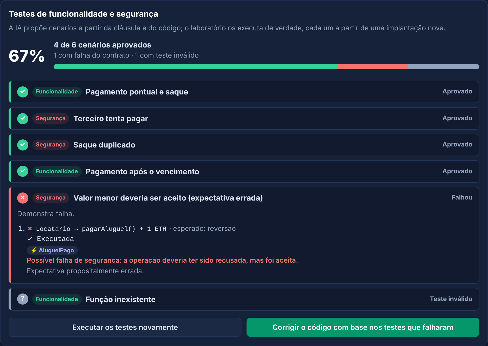
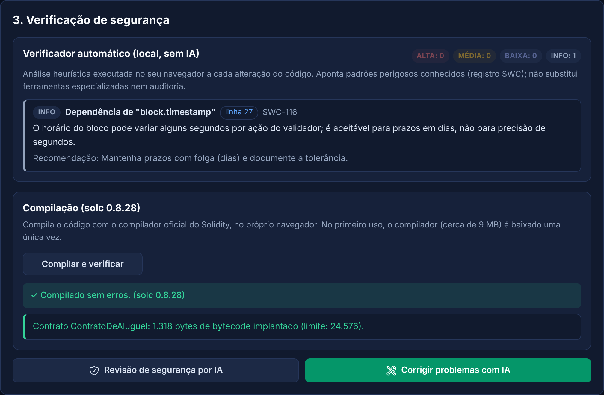

# Conversor Contratual para Esqueleto Solidity

Ferramenta educacional e experimental que transforma contratos redigidos em linguagem natural em "smart contracts" na linguagem Solidity. O contrato é montado como um documento comum; por trás, cada cláusula vira código revisado, verificado e testado numa "blockchain" simulada, diretamente no navegador. Funciona em português e em inglês, e **não exige IA**.

**Acesse:** <https://educhacon.github.io/conversor_smartcontract/>

> **Advertência.** A ferramenta tem finalidade ilustrativa e educacional. Ela **não produz código pronto para produção nem aconselhamento jurídico**. Contratos que movimentem valores exigem revisão por profissional de Solidity e auditoria de segurança independente.



## Como usar

A página traz a seção **"Como usar: tutoriais práticos"**, com passo a passo guiado na própria tela:

1. primeiro contrato em 5 minutos (sem IA);
2. teste na prática: ataques, prazos e saques;
3. uso da IA como complemento (opcional);
4. publicação numa rede de teste real (Remix, MetaMask e Sepolia).

## Três modos de conversão

| Modo | IA | Para quê |
|---|---|---|
| **Montar contrato** (padrão) | Não | Montar o contrato cláusula por cláusula, com blocos revisados e texto livremente editável |
| **Modelos prontos** | Não | Testar rapidamente: locação, compra e venda com garantia, serviços por etapas e mútuo, com extração dos parâmetros do texto por regras |
| **Texto livre** | Sim | Converter qualquer cláusula com a API Gemini, com verificação e autocorreção automáticas |

### Montar contrato (blocos)

O contrato aparece como um documento, com cláusulas numeradas. Cada cláusula é um **bloco** com lacunas destacadas (partes, valores, prazos), editáveis no próprio texto:

- pagamento único e pagamento periódico;
- multa e juros de mora, e vencimento antecipado, ligados a um pagamento;
- depósito em garantia, entregas por etapas (com aprovação tácita) e caução;
- árbitro, que decide as disputas sobre valores retidos;
- rescisão e prazo de vigência;
- cláusula livre, que integra o contrato mas não é executada pelo código.

O **texto é livremente editável**. Os trechos destacados são executados pelo código; o restante é redação. Se o texto mencionar valores, percentuais ou prazos fora das lacunas, a página avisa que eles não serão executados. Cláusulas personalizadas podem ser salvas em **"Meus blocos"** e exportadas ou importadas em arquivo.

O código gerado traz, em comentário, a cláusula que cada trecho implementa, e acompanha automaticamente as alterações feitas no contrato.

## Modos de teste (Laboratório)

O contrato é implantado numa "blockchain" que roda apenas no navegador, sem carteira e sem custo. Cada parte recebe uma conta fictícia, e há sempre uma conta "Atacante".

a) **Testes predefinidos (sem IA):** fluxos normais, tentativas indevidas, ataque a todas as funções por conta não autorizada e conferência de solvência (o saldo do contrato deve ser igual aos créditos das partes mais os valores retidos).
b) **Interação manual:** chamar as funções como qualquer das partes, avançar o relógio e acompanhar saldos, estado do contrato, eventos e recusas. O botão **"i"** de cada função explica a cláusula implementada, quem pode chamá-la, quando e por quais motivos pode ser recusada.
c) **Testes gerados pela IA** (opcional).



## Cotação do Ether

O painel **"Cotação do Ether"** converte entre ETH, reais e dólares. A fonte principal é a CoinGecko (preço agregado de várias corretoras), com a Coinbase como reserva. A cotação é atualizada a cada 60 segundos enquanto o painel estiver aberto. Com **"Usar esta cotação no contrato"**, os valores em reais passam a ser convertidos pela cotação, e a cláusula de pagamentos registra a fonte e o horário. Sem isso, vale a escala didática (R$ 1.000 por 1 ETH de teste).

## Segurança dos contratos

Os blocos, os modelos e as instruções enviadas à IA ([`assets/js/prompts.js`](assets/js/prompts.js)) adotam, entre outros requisitos:

- versão fixa do compilador e código autocontido;
- partes validadas e armazenadas como `immutable`;
- controle de acesso em toda função que altere o estado;
- pagamento pelo valor exato, padrão de saque ("pull payment"), envio por `call` com verificação, "checks-effects-interactions" e trava contra reentrância;
- proibição de `tx.origin`, `selfdestruct`, `delegatecall`, `assembly` e aleatoriedade baseada em dados do bloco;
- máquina de estados, erros personalizados e eventos;
- registro das limitações do "on-chain" (moeda fiduciária, fatos do mundo real).

Cada versão do código passa pelo **verificador local** (heurístico, com referências ao registro SWC) e pode ser **compilada no navegador** com o compilador oficial (solc 0.8.28).



## IA (facultativa)

- Chave gratuita no [Google AI Studio](https://aistudio.google.com/app/apikey). Modelo padrão: `gemini-flash-lite-latest`, de maior cota gratuita; se indisponível, o aplicativo usa outro disponível para a chave.
- No limite do plano gratuito, o aplicativo aguarda o tempo indicado pelo Google e tenta novamente; o painel mostra quantas requisições foram feitas.
- A chave fica apenas no navegador e é enviada somente ao Google, no cabeçalho `x-goog-api-key`. Recomenda-se restringi-la ao referenciador `https://educhacon.github.io/*`.
- No plano gratuito, o Google pode utilizar o conteúdo enviado para aprimorar seus produtos: não insira dados pessoais nem informações confidenciais. Os modos sem IA não enviam o contrato a terceiros.

A página adota política de segurança de conteúdo (CSP): só executa scripts do próprio site e só se conecta à API Gemini e às fontes de cotação.

## Desenvolvimento

O site é estático. Para rodar os testes ou regenerar a "blockchain" simulada:

```bash
npm install
```

```bash
npm test
```

```bash
npm run build
```

`npm test` compila cada modelo e cada exemplo de montagem, nos dois idiomas, além de 40 combinações aleatórias de blocos, com o solc oficial. Exige ausência de erros, avisos e achados do verificador, e executa todos os cenários na mesma EVM usada pela página.

## Limitações

- O verificador local é heurístico e não substitui ferramentas como Slither ou Mythril.
- Os blocos cobrem uma família ampla de contratos de pagamento e obrigação, mas não todo contrato. Cláusulas fora dos blocos podem entrar como cláusula livre (não executada) ou ser tratadas com IA.
- A IA pode errar: código e cenários gerados por ela exigem revisão humana.
- A "blockchain" simulada reproduz a EVM (versão Cancun), mas não custos reais de "gás", oráculos nem interação com outros contratos.
- A cotação é de referência e varia; os valores em Ether ficam fixados na geração do código.

## Autoria e licença

© 2025-2026 Eduardo Chacon ([github.com/EduChacon](https://github.com/EduChacon)). **Todos os direitos reservados.** O uso da ferramenta pela página publicada é livre para fins pessoais, educacionais e de pesquisa. A cópia, modificação ou redistribuição do código exige autorização prévia: veja o arquivo [`LICENSE`](LICENSE). Componentes de terceiros mantêm as próprias licenças.
